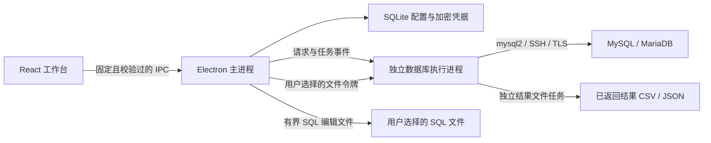

# 技术架构

## 进程边界

渲染进程启用沙箱、上下文隔离，关闭 Node 集成；不能直接调用文件系统、打开任意新窗口或浏览外部页面。SQL 编辑器及字体资源均从客户端本地加载。主进程仅接受当前主窗口顶层页面发出的固定命令，并使用 Zod 校验所有输入。

数据库引擎通过 utility process 运行。IPC 中使用普通对象与可序列化值；精确数字保留字符串，二进制值使用带类型标签的 Base64 数据。引擎故障会拒绝等待中的操作并使会话失效，不自动重放请求。

## 会话和任务

连接配置与数据库会话分别管理。每个查询标签固定使用一个连接，因此事务、临时表和会话变量保留在该标签中；元数据、表格及访问服务器的导入/整表导出任务使用独立连接。取消使用任务编号定位正在执行的数据库操作，任务结束后清理连接和流。

表格修改必须具备可靠行标识，更新及删除还比较旧值。任意一行冲突时整批修改回滚；非事务表不开放表格写入。任意查询结果首版只读，避免无法确定更新来源时修改错误记录。

导入、导出及查询采用有边界的分批处理。文件路径由用户通过本机对话框选择，渲染页面拿到短期令牌；主进程校验读写目的后才将路径交给引擎。

主分支新增的已返回结果导出由 utility process 内 `ResultFileTasks` 独立管理，不需要数据库连接或会话，也不接收原 SQL。它与数据库任务共用编号空间、进度事件和取消入口，逐行写入同目录临时文件，在同步、关闭及取消检查后原子替换。开始替换是保存提交点，之后到达的取消不能误报已保存文件为取消。IPC 原位遍历校验行数、列数、类型和体积，不深拷贝整个结果；列描述顺序决定输出，重复/空名显式生成唯一标题。

SQL 编辑文件的小型读写由主进程处理，最多 20 MiB、2000 万字符；令牌还需匹配 query/sql 或 export/sql 授权。UTF BOM 检测、非法编码拒绝、短写和原目标保护集中在 `queryFiles.ts`，正常退出等待文件操作结束。打开文件仅建立新查询标签，执行仍需用户单独操作；更大 SQL 脚本继续使用流式文件任务。

## 本地持久化

sql.js 提供真实 SQLite 文件，避免附带与平台 ABI 绑定的数据库模块。配置库体积受历史及任务条数约束，修改后写入临时文件再原子替换。迁移使用 SQLite 事务与 `user_version`；新版本配置库不能被旧版本静默覆盖。

凭据通过操作系统加密能力保护，保存的连接记录不包含明文密码。加密不可用时仅在内存中保存。应用重启后对未完成任务标记失败并要求核对结果。
