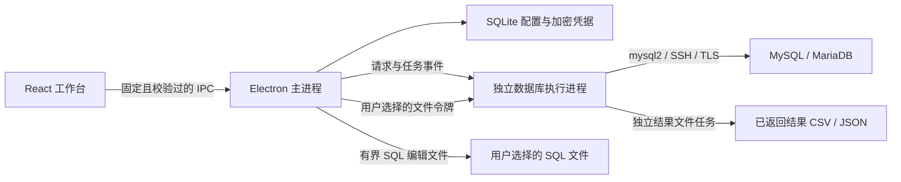

# 技术架构

## 进程边界

渲染进程启用沙箱、上下文隔离，关闭 Node 集成；不能直接调用文件系统、打开任意新窗口或浏览外部页面。SQL 编辑器及字体资源均从客户端本地加载。主进程仅接受当前主窗口顶层页面发出的固定命令，并使用 Zod 校验所有输入。

数据库引擎通过 utility process 运行。IPC 中使用普通对象与可序列化值；精确数字保留字符串，二进制值使用带类型标签的 Base64 数据。引擎故障会拒绝等待中的操作并使会话失效，不自动重放请求。

## 会话和任务

连接配置与数据库会话分别管理。每个查询标签固定使用一个连接，因此事务、临时表和会话变量保留在该标签中；元数据、表格及访问服务器的导入/整表导出任务使用独立连接。取消使用任务编号定位正在执行的数据库操作，任务结束后清理连接和流。

表格修改必须具备可靠行标识，更新及删除还比较旧值。任意一行冲突时整批修改回滚；非事务表不开放表格写入。任意查询结果首版只读，避免无法确定更新来源时修改错误记录。

导入、导出及查询采用有边界的分批处理。文件路径由用户通过本机对话框选择，渲染页面拿到短期令牌；主进程校验读写目的后才将路径交给引擎。

主分支新增的已返回结果导出由 utility process 内 `ResultFileTasks` 独立管理，不需要数据库连接或会话，也不接收原 SQL。它与数据库任务共用编号空间、进度事件和取消入口，逐行写入同目录临时文件，在同步、关闭及取消检查后原子替换。开始替换是保存提交点，之后到达的取消不能误报已保存文件为取消。IPC 原位遍历校验行数、列数、类型和体积，不深拷贝整个结果；列描述顺序决定输出，重复/空名显式生成唯一标题。

SQL 编辑文件的小型读写由主进程处理，最多 20 MiB、2000 万字符；令牌还需匹配 query/sql 或 export/sql 授权。UTF BOM 检测、非法编码拒绝、短写和原目标保护集中在 `queryFiles.ts`，正常退出等待文件操作结束。打开文件仅建立新查询标签，执行仍需用户单独操作；更大 SQL 脚本继续使用流式文件任务。

## SQL 片段与类型参数（0.3.0 已发布）

会话模式及事务状态通过锁定 mysql2 补丁的 OK/EOF 事件缓存。ERR 包不含这些当前状态，错误事件只使缓存转为待核对，不携带错误正文或参数值；`query.sessionState` 纯读缓存返回事务是否确定。界面保留关闭保护，并允许用户明确提交或回滚，不能以旧缓存假称错误后仍有或没有事务。模式不确定时扫描器分别保留各候选词法状态，只有完整语句边界及参数位置全部一致才放行；歧义明确报错，不发送附加探测 SQL 或重放写入。

SQL 片段通过 `snippets.list/save/delete` 进入主进程本地存储，不交给数据库执行进程，不混入 `SavedQuery` 或 `AppSettings`。每条记录有独立 ID、名称、分组、说明、正文和更新时间；允许同名同组记录，更新仅覆盖目标 ID。共享校验约束字段、500 条记录和用户正文 4 MiB UTF-8 总预算；内置模板仅在渲染端提供，不计入持久化配额。界面在打开模态前保存查询选区和模型引用，插入时核对同一模型及标签仍存在，再通过普通 Monaco `executeEdits` 和前后撤销边界替换选区；不使用片段插值或 `setValue`，不改变结果、事务及数据库会话。

类型参数由 `query.parameterNames` 与 `query.executeParameterized` 走原查询标签的固定会话。表单固定捕获的 SQL 模板，类型为文本、整数、小数、布尔、日期、日期时间、时间/时长、二进制和 NULL；值只保留在本次表单及执行请求中。共享校验限制名称、类型、精度和 UTF-8 预算：200 个名称、单值 64 KiB、合计 1 MiB、单条 100000 处占位符、模板与展开 SQL 各合计 20 MiB。精确数值不经过 JavaScript `Number`；文本转为 UTF-8 十六进制表达式，其他值生成经过类型校验的字面量或类型表达式。绑定只替换词法扫描确认的 `:name` 位置，不替换引号或普通注释内容，不接受标识符参数。

引擎先读取该会话的协议缓存模式，以 `NO_BACKSLASH_ESCAPES` 和 `ANSI_QUOTES` 驱动脚本及参数扫描。静态可确定路径在首条用户 SQL 前验证完整模板、参数对应关系与展开预算，常量 `SET sql_mode` 可预演；动态模式边界之后名称预览只是候选集合。真正执行按条读取最新缓存模式、重新扫描和绑定，并累计预算；动态路径可能在前面的写入已经提交后才发现后续缺参、解析错误或多余参数。失败或取消停止后续语句，不自动回滚已有事务，不撤销已提交语句、DDL 或重放请求。

会话模式和事务状态由协议跟踪维护，参数识别与执行间不插入诊断 `SELECT`，避免覆盖 `ROW_COUNT()`、`FOUND_ROWS()` 或警告；缓存状态不可信时拒绝本次操作。`query.sessionState` 只读取缓存，用于错误后的事务和断线提示。任务仍使用统一取消和会话互斥边界。主进程历史记录保存模板，参数任务/历史失败消息作保护处理；流式结果与最终 `QueryResult.statement` 使用原模板，结果单元格仍可包含真实值，不能把“值不持久化”解释为结果内容脱敏。

## 外键选择与关联读取

`table.referencePage` 仅接受来源连接、库、表、约束名和有界的关联元组，不接收界面指定的父表。引擎重读源及目标元数据并规范列名，父表标识符大小写保持真实服务器语义；关联匹配独立于普通筛选组，复合元组不可拆开。父表须具备可靠非空唯一键，页大小、单行和整页预算沿用普通表页。

独立任务在建连前登记编号及 AbortSignal，直到控制取消和资源 close 完成才发送终态并释放编号。元数据锁等待需要独立控制连接结束本次服务器线程，仅销毁本地 TCP 流不足以证明服务端已结束；取消控制失败返回明确失败。`metadata.table` 可携带 taskId 复核源定义，因此清空 NULL 不依赖父表读取权限。退出等待已有及迟到建立的连接，拒绝新任务，关联操作不借用普通查询会话。

界面捕获源行及元数据代次，确认前重新核对父行及映射，将复合元组一次应用到原 DraftRow。窗口关闭后忽略迟到响应，活动计数等待实际 IPC 完成。表页和整表导出包含 FLOAT/DOUBLE 时采用二进制结果协议，避免服务器文本格式缩短有效位；任意用户 SQL 的协议精度改进仍需独立实现及诊断状态验证，不能在失败后回退重放。BIT 二进制写值与可靠键/完整原值比较使用类型感知的 unsigned 转换，并检查声明位宽。

## 不一致模式状态的处理

五库实测存储程序恢复调用前 sql_mode 后，协议 NBE 位可能仍保留程序内的值，并延续到后续普通 EOF。完整变量报告与状态位矛盾时降为不确定，不透明 CALL/EXECUTE 和 ERR 也不能证明词法模式；普通成功包独立恢复事务状态，不能重新信任词法状态。只有收到完整且同包状态一致的模式报告或新建连接，才能恢复词法缓存。未知时扫描语句及参数的所有候选模式，边界不同则停止，字符串中的字面 `:name` 不会被替换。任意同值 SET 或 tracker 关闭后的 SET 不保证报告完整模式，没有追加状态查询或改变 mysql2 错误事件的隐私边界。

## 本地持久化

sql.js 提供真实 SQLite 文件，避免附带与平台 ABI 绑定的数据库模块。配置库体积受历史及任务条数约束，修改后写入临时文件再原子替换。迁移使用 SQLite 事务与 `user_version`；新版本配置库不能被旧版本静默覆盖。

SQL 片段使 `user_version` 从 1 升到 2，新增 `sql_snippets` 表，保留已有记录。事务快照同时保护内存数据库与会话凭据：迁移、保存或删除写盘失败会恢复修改前状态，后续设置保存不会偷偷提交失败操作；打开期间迁移失败会释放实例。旧 0.2.0 的配置上限为 1，不能读取新库。升级前应退出应用并备份整个用户配置目录；回退前也保留当前目录，再恢复升级前完整备份，不能删除新库、强改版本号或以重置掩盖格式不兼容。

凭据通过操作系统加密能力保护，保存的连接记录不包含明文密码。加密不可用时仅在内存中保存。应用重启后对未完成任务标记失败并要求核对结果。
